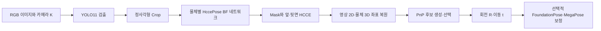

# HCCEPose 프로젝트 분석 보고서

- 작성일: 2026-11-03 (Asia/Seoul)
- 분석 대상: `/RESEARCH_DATA/HCCEPose`
- 목적: SMT 제조 공정의 RGB 이미지 기반 6D Pose 연구를 위한 기존 구현, 자산, 평가 체계 및 확장 과제 파악
- 분석 방법: 로컬 코드·README·파일 목록·압축파일 목록·저장된 결과 이미지에 대한 정적 분석

## 확인 범위와 표기

- **[확인]** 로컬 코드 또는 파일에서 직접 확인한 사실이다. 코드 설정은 실행 결과와 구분한다.
- **[문서 주장]** README에 적힌 설명이며, 이번 분석에서 재현하거나 외부 서비스에서 검증하지 않았다.
- **[해석]** 구현으로부터 도출한 의미 또는 연구상 제약이다.
- **[제안]** 후속 작업·실험안이며 아직 수행하지 않았다.
- **[미확인]** 이번에 확인할 수 없었던 자산·성능·메타데이터이다.

서버 전체 저장소를 조사한 것이 아니라 **현재 프로젝트 디렉터리와 그 안의 압축파일**을 확인했다. 따라서 프로젝트 밖의 SMT obj04 데이터셋이나 체크포인트가 서버에 존재하지 않는다고 단정하지 않는다. GPU 학습·추론, 프로젝트 Python 모듈 실행, 패키지 설치, 환경 변경, 외부 다운로드·파일 전송은 수행하지 않았다. 보고서 작성 전 Git 작업 트리에는 변경 사항이 없었다. 이 작업에서는 본 보고서만 새로 생성한다.

## 1. 프로젝트 디렉터리 구조와 주요 파일 역할

**[확인]** 보고서 생성 전 `.git`을 제외한 프로젝트 파일은 92개였다. 주요 구조는 다음과 같다.

```text
HCCEPose/
├── HccePose/
│   ├── network_model.py
│   ├── bop_loader.py
│   ├── PnP_solver.py
│   ├── tester.py
│   ├── metric.py
│   ├── visualization.py
│   ├── hccepose_acceleration.py
│   ├── ensure_rgbd_megapose_demo.py
│   └── test_script_utils.py
├── Refinement/
│   ├── foundationpose.py
│   ├── foundationpose_acceleration.py
│   ├── MegaPose.py
│   ├── refinement_group.py
│   └── refinement_test_utils.py
├── yolo_train/                 # label.py, train.py
├── scripts/                    # 다운로드 보조 스크립트 2개
├── show_vis/                   # 예제 시각화·GIF·BOP 결과 캡처
├── test_imgs/                  # RGB 이미지 2장
├── test_imgs_RGBD/             # RGB·Depth·카메라 JSON 4세트
├── test_videos/                # MP4 1개
├── s1_*.py                     # CAD 전처리·대칭·모델 정보
├── s2_*.py, s2_*.sh            # PBR 합성 데이터 생성
├── s3_*.py                     # YOLO 라벨 변환·학습
├── s4_p1_*.py                  # 앞·뒷면 좌표 라벨 생성
├── s4_p2_*.py                  # Pose 학습·평가·BOP 출력
├── s4_p3_*.py                  # RGB·영상·RGB-D·가속 데모
├── bop_toolkit.zip
├── blenderproc.zip
├── requirements-inference.txt
├── README.md, README_CN.md
└── LICENSE
```

| 주요 파일 | 확인한 역할 |
|---|---|
| [HccePose/network_model.py](HccePose/network_model.py) | 백본·ASPP·출력 헤드, HCCE 손실과 복호화, 체크포인트 저장·복원 |
| [HccePose/bop_loader.py](HccePose/bop_loader.py) | BOP 모델·장면 로딩, 앞·뒷면 좌표 라벨 렌더링, 대칭 처리, 데이터 증강·정규화 |
| [HccePose/PnP_solver.py](HccePose/PnP_solver.py) | 2D–3D 대응점으로 PnP 수행, 앞·뒷면 후보 조합과 선택 |
| [HccePose/tester.py](HccePose/tester.py) | 검출·crop·물체별 Pose 추론·선택적 보정·시각화 통합 |
| [HccePose/metric.py](HccePose/metric.py) | ADD/ADD-S 오차와 직경 10% 기준 통과율 |
| [HccePose/hccepose_acceleration.py](HccePose/hccepose_acceleration.py) | ONNX 내보내기, ONNX Runtime 및 TensorRT 실행 경로 |
| [HccePose/ensure_rgbd_megapose_demo.py](HccePose/ensure_rgbd_megapose_demo.py) | 데모 환경·의존성·가속 백엔드 준비; 일부 경로에 자동 설치 포함 |
| [Refinement/refinement_group.py](Refinement/refinement_group.py) | FoundationPose·MegaPose 보정 통합 및 MegaPose 별도 환경 실행 |
| [Refinement/foundationpose.py](Refinement/foundationpose.py), [Refinement/MegaPose.py](Refinement/MegaPose.py) | 각 보정 알고리즘의 모델·입출력·렌더링 관련 구현 |
| [Refinement/refinement_test_utils.py](Refinement/refinement_test_utils.py) | RGB-D 프레임 읽기, 깊이 단위 변환, 렌더링 깊이 비교 |
| [yolo_train/label.py](yolo_train/label.py), [yolo_train/train.py](yolo_train/train.py) | 다중 물체 검출 라벨 변환 및 YOLO11 학습 |
| [scripts/download_hf_assets.py](scripts/download_hf_assets.py), [scripts/wget_hf_demo_assets.py](scripts/wget_hf_demo_assets.py) | 외부 데모 데이터·가중치 다운로드 도구; 이번에는 실행하지 않음 |
| [requirements-inference.txt](requirements-inference.txt) | 추론 중심 의존성 목록; 완전한 학습·렌더링 환경 명세와는 구분 필요 |

## 2. 모델 아키텍처 및 핵심 알고리즘

### 2.1 전체 구조

**[확인]** 현재 통합 추론은 다음 단계로 구성된다.



근거: [HccePose/tester.py](HccePose/tester.py)의 `Tester.__init__`, `Tester.predict`; [HccePose/network_model.py](HccePose/network_model.py)의 `HccePose_BF_Net`.

### 2.2 백본·디코더·출력

**[확인]** 기본 백본은 ResNet-34를 수정한 Output Stride 8 구조이다. 후반부에 dilation 2·4의 BasicBlock을 사용한다. ASPP는 1×1 합성곱, dilation 6·12·18의 3×3 합성곱, 전역 풀링 분기를 결합한다. 전치 합성곱과 skip feature 결합으로 해상도를 복원한다.

`efficientnet_key`가 `None`이 아니면 수정된 EfficientNet-B4와 별도 ASPP 디코더를 선택한다. 기본 학습 스크립트는 ResNet 경로, BOP LM-O 출력 스크립트는 EfficientNet 경로를 설정한다. 모든 경로가 동일한 백본으로 실행되는 것은 아니다.

| 항목 | 기본 crop에서의 구성 |
|---|---|
| 입력 | B×3×256×256 |
| 출력 | B×49×128×128 |
| Mask | 1채널 |
| 앞면 코드 | XYZ 각 8단계, 총 24채널 |
| 뒷면 코드 | XYZ 각 8단계, 총 24채널 |

앞·뒷면은 공유 백본·디코더의 출력 채널을 나누는 구조이다. `Tester`는 물체마다 별도 네트워크와 체크포인트를 로드한다.

근거: [HccePose/network_model.py](HccePose/network_model.py)의 `ResNet_BasicBlock_OS8`, `ASPP`, `efficientnet_upsampled`, `DeepLabV3`, `HccePose_BF_Net`; [s4_p2_train_bf_pbr.py](s4_p2_train_bf_pbr.py); [s4_p2_test_bf_pbr_bop_challenge.py](s4_p2_test_bf_pbr_bop_challenge.py).

**[해석]** 현재 구현은 CAD와 물체별 학습을 전제로 하는 방식이다. 보지 못한 SMT 물체를 학습 없이 처리하는 성능은 이 코드와 자료에서 확인할 수 없다. 물체 종류가 늘면 네트워크 로드 비용과 메모리도 검토해야 한다.

### 2.3 HCCE 좌표 표현

**[확인]** 라벨 생성 시 물체 표면의 XYZ를 축별 최소 좌표와 크기로 정규화해 0~255 정수로 저장한다. 학습 시 각 축을 8단계 연속값으로 변환한다. 단계별 나머지 연산과 정규화를 적용하고, 상위 단계가 0.5 이상인 영역에서 다음 단계 값을 반전한다.

추론 시 sigmoid 출력의 임계값 처리를 통해 이진 코드를 만들고, 재귀 절댓값 차분 및 2의 거듭제곱 가중합으로 축별 정수 좌표를 복원한다. 학습 표적 자체는 연속값이므로 단순한 비트 분류와 구분해야 한다.

```text
X_obj = (decoded_code / 255) * size_xyz + min_xyz
```

근거: [HccePose/bop_loader.py](HccePose/bop_loader.py)의 `rendering_bop_dataset_back_front.__getitem__`, `train_bop_dataset_back_front.hcce_encode`; [HccePose/network_model.py](HccePose/network_model.py)의 `hcce_decode`, `inference_batch`.

**[해석]** 축별 양자화 간격은 `size_axis/255`이다. 이는 최종 Pose 오차의 직접적인 하한이라고 단정할 수 없으나, SMT 요구 정밀도와 비교할 좌표 표현 해상도이다.

### 2.4 앞·뒷면 PnP와 후보 선택

**[확인]** 동일 영상 위치의 앞·뒷면 3D 좌표를 이용해 네 종류의 후보를 생성한다: 앞면만, 뒷면만, 앞·뒷면 교대, 앞·뒷면 사이 보간점 포함. EPNP, RANSAC, RANSAC+VVS 보정을 지원한다.

학습 중 검증에서는 네 후보의 비어 있지 않은 부분집합 15개를 비교한다. 각 부분집합에서 내점 수가 가장 많은 후보를 골라 ADD(-S) 통과율을 계산하고, 그 배열을 체크포인트의 `keypoints_`에 저장한다. 추론에서는 이 통계의 최댓값 인덱스로 사용할 후보 부분집합을 정한다. **`keypoints_`는 실제 3D 키포인트 좌표가 아니다.**

근거: [HccePose/PnP_solver.py](HccePose/PnP_solver.py)의 `solve_PnP`, `solve_PnP_comb`; [s4_p2_train_bf_pbr.py](s4_p2_train_bf_pbr.py)의 `test`.

### 2.5 학습 손실

**[확인]** Mask는 sigmoid 후 L1, 좌표 코드는 연속 표적을 `[-1, 1]`로 변환한 L1을 사용한다. 축별·채널별 오류 이력을 최대 100개 유지하며 손실 가중치를 조정한다.

```text
L = L_mask + 3 * sum(L_front_xyz) + 3 * sum(L_back_xyz)
```

좌표 손실은 예측 Mask를 이진화한 영역에 적용한다. 근거: [HccePose/network_model.py](HccePose/network_model.py)의 `HccePose_Loss`; [s4_p2_train_bf_pbr.py](s4_p2_train_bf_pbr.py)의 `l_l`과 `loss` 계산.

**[해석]** 예측 Mask에서 누락된 영역은 좌표 손실에서도 제외된다. 작은 부품의 초기 Mask 학습과 좌표 학습이 서로 영향을 줄 수 있으므로 GT Mask 기반 손실과 비교할 가치가 있다. 실제 악화 여부는 미검증이다.

## 3. 데이터 전처리·학습·추론·평가 파이프라인

### 3.1 CAD·합성 데이터·라벨 준비

| 단계 | 확인한 처리 | 근거 |
|---|---|---|
| CAD 정렬 | 축 정렬 경계 상자 중심을 원점으로 이동, BOP 파일명으로 저장 | [s1_p1_obj_rename_center.py](s1_p1_obj_rename_center.py) |
| 대칭 분석 | KASAL GUI로 회전 대칭 정의 | [s1_p2_obj_symmetry.py](s1_p2_obj_symmetry.py) |
| 모델 정보 | 직경, min/max, size, 대칭 정보를 `models_info.json`으로 저장 | [s1_p3_obj_infos.py](s1_p3_obj_infos.py) |
| PBR 생성 | 물리 배치, 재질·조명·배경·카메라 시점 무작위화, BOP 저장 | [s2_p1_gen_pbr_data.py](s2_p1_gen_pbr_data.py), [s2_p1_gen_pbr_data.sh](s2_p1_gen_pbr_data.sh) |
| YOLO 라벨 | `bbox_visib` 변환, 가시율·가시 픽셀 수 필터, 학습·검증 목록 생성 | [s3_p1_prepare_yolo_label.py](s3_p1_prepare_yolo_label.py), [yolo_train/label.py](yolo_train/label.py) |
| 검출기 학습 | detection 기본 가중치 `yolo11x.pt`, 증강·재개 학습 지원 | [s3_p2_train_yolo.py](s3_p2_train_yolo.py), [yolo_train/train.py](yolo_train/train.py) |
| XYZ 라벨 | CAD·GT 자세로 앞·뒷면 깊이 렌더링 후 물체 좌표 복원·PNG 저장 | [s4_p1_gen_bf_labels.py](s4_p1_gen_bf_labels.py), [HccePose/bop_loader.py](HccePose/bop_loader.py) |

**[확인]** PBR Python 스크립트는 한 호출당 50개 물리 배치와 배치당 20개 시점, 총 1,000장으로 설정되어 있다. 셸은 Python 호출을 반복한다. 이 수는 생성 설정이며 실제 보유 데이터 수가 아니다. 모델 로딩에는 `mm2m=True`, BOP 출력에는 `depth_scale=0.1`을 설정한다.

### 3.2 BOP 형식과 전처리

**[확인]** 일반적으로 기대하는 배치는 다음과 같다. 현재 프로젝트에 이 학습 데이터 트리가 실제 존재하는 것은 아니다.

```text
dataset/
├── models/
│   ├── obj_000004.ply
│   └── models_info.json
├── train_pbr/
│   └── 000000/
│       ├── rgb/
│       ├── depth/
│       ├── mask/
│       ├── mask_visib/
│       ├── scene_camera.json
│       ├── scene_gt.json
│       └── scene_gt_info.json
├── train_pbr_xyz_GT_front/
└── train_pbr_xyz_GT_back/
```

주요 필드는 `cam_K`, `cam_R_m2c`, `cam_t_m2c`, `obj_id`, `bbox_visib`, `visib_fract`, `depth_scale`이다. Pose는 `X_camera = R * X_model + t` 규약을 따른다. `models_info.json`에는 직경과 XYZ 경계·크기 및 선택적인 대칭 정보가 필요하다.

학습 데이터는 가시율 0.2 이상을 로드한다. 가시 bounding box를 확대·이동해 RGB 256×256과 라벨 128×128을 만든다. RGB에는 밝기·대비·블러·노이즈·dropout 등 증강을 적용한다. OpenCV BGR 순서를 유지하며 ImageNet 통계를 BGR 순서로 재배열해 정규화한다. 대칭 물체 라벨 생성에서는 동등 자세 중 대표 자세를 선택한다.

근거: [HccePose/bop_loader.py](HccePose/bop_loader.py)의 `bop_dataset`, `modified_sym_Rt`, `train_bop_dataset_back_front`; [yolo_train/label.py](yolo_train/label.py).

### 3.3 HccePose 학습

**[확인: 코드 기본값]** 아래 값은 실제 학습 실행 기록이 아니다.

| 설정 | 값 |
|---|---|
| 데이터 루트 | `/root/xxxxxx/demo-tex-objs` 예시 경로 |
| 학습 split | `train_pbr` |
| 물체 ID | 1~5를 순차 학습 |
| 백본 | ResNet 경로 |
| 최적화 | Adam, 학습률 0.0002 |
| 배치·worker | 24·12 |
| 종료 조건 | 50,001 iteration |
| 검증·저장 간격 | 500 iteration |
| 검증 자료 | 같은 `train_pbr`의 앞쪽 1% |
| 정밀도·실행 | AMP·GradScaler, 기본 단일 GPU, 선택적 DDP |

일부 주석은 epoch라고 표현하지만 실제 반복 종료 조건은 optimizer step이다. `ratio=0.01`은 무작위 추출이 아니라 길이를 1%로 줄여 앞부분을 읽는다. 후보 조합 선택과 최고 체크포인트 선정도 이 자료에 의존한다.

근거: [s4_p2_train_bf_pbr.py](s4_p2_train_bf_pbr.py); [HccePose/bop_loader.py](HccePose/bop_loader.py)의 `test_bop_dataset_back_front.update_obj_id`.

### 3.4 RGB·RGB-D 추론

**[확인]** 입력 영상의 긴 변이 640을 넘으면 축소하고 내부 파라미터 K를 함께 조정한다. 영상 크기를 32 배수로 padding하고 주점도 이동한다. YOLO 검출을 클래스별로 모은 뒤 1.5배 확대 crop, 물체별 네트워크, 좌표 복원, CPU OpenCV PnP를 수행한다. 결과에는 물체별 `Rts`, Mask·좌표·confidence와 시간 정보가 포함된다.

FoundationPose는 깊이 입력을 요구하며 MegaPose에는 RGB/RGB-D 경로가 있다. HccePose의 CAD·이동량 단위와 보정 모델의 m 단위 사이 변환을 수행한다. 입력 depth는 통합 추론 인터페이스에서 m 단위를 기대한다. 별도 프레임 유틸리티에는 깊이 중앙값으로 단위를 추정하는 구현이 있다.

근거: [HccePose/tester.py](HccePose/tester.py)의 `predict`, `_run_foundationpose_refinement`, `_run_megapose_refinement`; [Refinement/refinement_group.py](Refinement/refinement_group.py); [Refinement/refinement_test_utils.py](Refinement/refinement_test_utils.py)의 `convert_depth_to_meter`.

### 3.5 평가

**[확인]** 내부 평가는 대칭 정보 키가 있으면 ADD-S, 없으면 ADD를 계산하고 직경의 10% 미만을 성공으로 처리한다. BOP 출력 스크립트는 segmentation RLE JSON과 Pose CSV를 생성하며 CSV 열은 `scene_id, im_id, obj_id, score, R, t, time`이다. 저장 시간 값은 `-1`이다. 현재 기본값은 LM-O, GDRNPP 검출 결과, EfficientNet, `ransac+vvs+comb`이다.

`s4_p2_test_bf_pbr.py`의 기본 평가도 `train_pbr` 앞쪽 1%와 GT bounding box를 사용한다. 통합 YOLO 포함 평가와 동일한 조건이 아니다. BOP 출력 스크립트 자체가 VSD/MSSD/MSPD 종합 점수를 계산하지는 않는다. 압축된 BOP toolkit에는 `eval_bop19_pose.py`, `eval_calc_errors.py`, `eval_calc_scores.py` 등이 있다.

근거: [HccePose/metric.py](HccePose/metric.py); [s4_p2_test_bf_pbr.py](s4_p2_test_bf_pbr.py); [s4_p2_test_bf_pbr_bop_challenge.py](s4_p2_test_bf_pbr_bop_challenge.py); `bop_toolkit.zip` 내부 `bop_toolkit/scripts/`.

## 4. 현재 서버에서 확인된 데이터셋과 체크포인트

**확인 범위는 서버의 현재 프로젝트 경로로 제한된다.**

| 자산 | 확인 결과 | 근거 경로 |
|---|---|---|
| RGB 입력 | 2장 | `test_imgs/IMG_20251007_165718.jpg`, `test_imgs/IMG_20251009_142305.jpg` |
| RGB-D 입력 | `000000`~`000003`의 RGB·Depth·카메라 JSON, 총 12파일 | `test_imgs_RGBD/` |
| 입력 영상 | MP4 1개 | `test_videos/VID_20251009_141247.mp4` |
| 시각화 자료 | 검출·Pose·보정 결과 이미지·GIF 및 BOP 캡처 존재 | `show_vis/` |
| BOP 학습 데이터·CAD | 프로젝트 루트에서 해당 학습 트리 미확인 | `demo-bin-picking/`, `demo-tex-objs/`, `lmo/` 없음 |
| SMT obj04 원본·GT·CAD | 미확인; 위치도 제공받지 않음 | 프로젝트 내 해당 데이터셋 트리 미확인 |
| HccePose·YOLO checkpoint | 프로젝트 안에서 미확인 | `.pt`, `.pth`, `.ckpt` 및 숫자형 파일명 검색 |
| 가속 산출물 | 미확인 | `.onnx`, `.engine` 검색 |
| 정량 기록 | 결과 CSV·학습 로그·TensorBoard 이벤트 미확인 | 프로젝트 파일 목록 검색 |

두 ZIP의 내부 파일 목록에서도 체크포인트 확장자 파일은 없었다. ZIP은 펼치지 않았으며, 코드 실행 여부나 설치 환경 정상 여부를 시험하지 않았다.

**[확인]** 체크포인트의 기대 저장 위치는 `dataset/HccePose/obj_XX/`와 그 하위 `best_score/`이다. 일반 체크포인트는 숫자 iteration 파일명이며 최근 3개를 유지하도록 호출한다. 최고 모델은 점수와 step을 파일명에 넣고 모델·optimizer 상태, `iteration_step`, `best_score`, 선택적으로 `keypoints_`를 저장한다.

근거: [HccePose/network_model.py](HccePose/network_model.py)의 `save_checkpoint`, `save_best_checkpoint`, `get_checkpoint`, `load_checkpoint`; [s4_p2_train_bf_pbr.py](s4_p2_train_bf_pbr.py).

**[문서 주장]** [README.md](README.md)의 BOP Challenge Testing 절은 LM-O·YCB-V·T-LESS·TUD-L·HB·ITODD·IC-BIN 가중치의 외부 링크를 제공한다. 실제 외부 파일의 현재 상태·내용은 확인하지 않았다. README의 일부 `hf-dataset-card/README.md` 참조 대상도 현재 파일 목록에는 없다.

## 5. 기존 실험 결과 및 실제 확인한 성능 지표

### 5.1 로컬 BOP 결과 캡처

**[확인: 이미지에 표시된 과거 값]** 다음 수치는 [show_vis/BOP-website-lmo.png](show_vis/BOP-website-lmo.png)를 직접 열어 확인했다. 제출명은 `HccePose(BF) 2024 + Default 2D BBOX/LM-O`, 제출 날짜 표시는 2025-10-20이다.

| 평가 항목 | 캡처 값 |
|---|---:|
| 6D localization AR | 0.755 |
| AR_MSPD | 0.898 |
| AR_MSSD | 0.769 |
| AR_VSD | 0.597 |
| 2D segmentation AP | 0.529 |
| AP50 | 0.898 |
| AP75 | 0.575 |
| AP_large | 0.661 |
| AP_medium | 0.637 |
| average_time_per_image | -1.000 |

이 값은 **현재 코드로 재현한 결과나 SMT obj04 성능이 아니다.** `-1.000`은 유효한 실행시간 측정으로 사용할 수 없다. 제출 파일 원본과 평가 로그가 로컬에 없어 수치의 재계산·현재 코드와의 대응은 검증하지 않았다.

**[문서 주장]** [README.md](README.md)는 2024 제출 대비 6D localization 점수 유지, segmentation 0.002 개선을 설명한다. 비교 실행이나 이전 제출 원본은 이번에 확인하지 않았다.

### 5.2 정성 결과와 미확인 성능

**[확인]** `show_vis/`에는 RGB Pose 결과와 FoundationPose·MegaPose 보정 시각화가 있다. 예: [RGB 검출](show_vis/IMG_20251007_165718_show_2d.jpg), [RGB Pose](show_vis/IMG_20251007_165718_show_6d_vis1.jpg), [FoundationPose](show_vis/rgbd_000003_foundationpose.jpg), [MegaPose RGB-D](show_vis/rgbd_000003_megapose_rgbd.jpg).

**[미확인]** SMT 정확도, obj04 정확도, 실제 추론 FPS, 가속 배율, 학습 수렴 곡선, 보정 전후 정량 개선은 확인할 기록이 없다. 시각화 파일만으로 정확도나 보정 효과를 수치화하지 않는다.

## 6. SMT obj04 데이터셋과 연결하기 위한 준비 사항

### 6.1 먼저 확인할 입력 명세

아래는 모두 **[제안]** 이며 obj04 데이터를 이미 조사했다는 의미가 아니다. 이름 `obj04`가 BOP `obj_id=4`를 뜻하는지도 확인해야 한다.

| 준비 항목 | 필요한 확인·작업 | 관련 코드 |
|---|---|---|
| 원본 위치·구조 | 읽기 전용 원본 경로, 이미지 수·세션·split·파일 형식 목록화 | [HccePose/bop_loader.py](HccePose/bop_loader.py)의 `load_folder` |
| CAD·단위·원점 | 정확한 부품 CAD, mm/m, 좌표축, 중심 이동 전후 변환 기록 | [s1_p1_obj_rename_center.py](s1_p1_obj_rename_center.py), [s1_p3_obj_infos.py](s1_p3_obj_infos.py) |
| 카메라 | 촬영 해상도·K·왜곡 보정 여부·crop/resize 이력 | [HccePose/tester.py](HccePose/tester.py)의 `predict` |
| Pose GT | object-to-camera 규약, R의 행렬 배치, t의 단위·형상, 획득 오차 | [HccePose/bop_loader.py](HccePose/bop_loader.py)의 `__getitem__` 구현들 |
| Mask·BBox | 인스턴스별 가시 Mask·가시 BBox·가시율, 동일 부품 다중 인스턴스 매칭 | [yolo_train/label.py](yolo_train/label.py), [HccePose/bop_loader.py](HccePose/bop_loader.py) |
| 대칭·극성 | 기하학적 대칭과 공정상 허용 자세 구분; 핀·표식 방향 검토 | [s1_p2_obj_symmetry.py](s1_p2_obj_symmetry.py), [HccePose/metric.py](HccePose/metric.py) |
| Depth 유무 | RGB만 있다면 Depth 없는 BOP 읽기 경로를 보완할 계획 수립 | [HccePose/bop_loader.py](HccePose/bop_loader.py)의 `load_folder` |
| 기존 가중치 | 외부 서버 경로에 있는지, 동일 CAD·단위·백본·채널·정규화인지 | [HccePose/network_model.py](HccePose/network_model.py)의 `load_checkpoint` |

### 6.2 연결 방식

**[제안]** 원본을 보존하고 별도 파생 데이터 루트에 BOP 변환본과 라벨을 생성하는 방식을 권장한다. `obj_id=4`로 확정한 경우 CAD는 `models/obj_000004.ply`, 모델 정보 키는 `"4"`, Pose 가중치 경로는 `HccePose/obj_04/best_score/`가 된다.

YOLO 클래스는 BOP ID와 별개이다. obj04 하나만 포함한 목록이라면 YOLO 클래스 인덱스는 0이 될 수 있다. 여러 물체를 포함하면 `models_info.json`에서 읽는 목록 순서와 YOLO 학습 시 클래스 순서를 동일하게 고정해야 한다.

근거: [yolo_train/label.py](yolo_train/label.py)의 `obj_id_list.index`; [HccePose/tester.py](HccePose/tester.py)의 클래스별 검출 선택·체크포인트 경로 구성.

**[제안]** 실제 RGB에 정확한 CAD·GT Pose가 있다면 `s4_p1`의 렌더링 라벨 생성 구조를 활용할 수 있다. 기존 학습 스크립트는 단일 폴더만 지정하므로, PBR+Real 혼합 및 독립 검증을 위해 데이터 소스·샘플링·split 설정을 명시적으로 설계해야 한다. 단순히 데이터 경로만 교체하면 충분하다고 보장할 수 없다.

근거: [s4_p1_gen_bf_labels.py](s4_p1_gen_bf_labels.py), [s4_p2_train_bf_pbr.py](s4_p2_train_bf_pbr.py), [HccePose/bop_loader.py](HccePose/bop_loader.py).

## 7. 확인된 코드 문제점과 연구상 한계

아래 문제는 정적 분석으로 확인했다. 오류가 있는 분기를 실제 실행하거나 학습 실패를 재현하지는 않았다.

| 우선순위 | 확인한 구현·문제 | 영향 및 개선 방향 | 근거 |
|---|---|---|---|
| 높음 | 검증이 학습 `train_pbr` 앞쪽 1%와 겹침 | 독립 일반화 성능으로 해석 불가; 장면·세션 단위 분리 | [s4_p2_train_bf_pbr.py](s4_p2_train_bf_pbr.py), `test_bop_dataset_back_front.update_obj_id` |
| 높음 | YOLO 변환 진입점에서 `dataset_name`에 전체 경로를 넣고 `dataset_path` 재사용 | 상대경로 중복 또는 잘못된 모델 정보 경로 구성; 루트·split·출력을 분리 | [s3_p1_prepare_yolo_label.py](s3_p1_prepare_yolo_label.py), 57행 이후 |
| 높음 | checkpoint 로더가 모든 예외를 잡아 기본 메타데이터 반환 | 실패가 호출자에 명확히 전달되지 않아 잘못된 모델 상태를 사용할 위험; 예외 구분·중단 필요 | [HccePose/network_model.py](HccePose/network_model.py)의 `load_checkpoint` |
| 높음 | PnP 일부 경로가 성공 여부 확인 전에 Rodrigues·재투영 수행 | 실패 반환값 처리 중 추가 오류 가능; 성공·내점·유한값 검사 선행 | [HccePose/PnP_solver.py](HccePose/PnP_solver.py)의 `solve_PnP` |
| 높음 | BOP 단일 PnP 분기에서 미정의 `pred_m_bf_c_np_i` 참조 | `epnp`, `ransac`, `ransac+vvs` 분기에서 오류 | [s4_p2_test_bf_pbr_bop_challenge.py](s4_p2_test_bf_pbr_bop_challenge.py), 153행 |
| 높음 | RGB-only BOP 로딩도 Depth 확장자를 문자열 결합 | Depth 파일이 없으면 `None` 결합 오류 가능; 선택 입력으로 처리 | [HccePose/bop_loader.py](HccePose/bop_loader.py)의 `load_folder` |
| 중간 | 좌표 라벨 누락을 0 이미지로 대체 | 잘못된 학습 표적을 조용히 수용; 사전 완전성 검사와 명시적 오류 필요 | [HccePose/bop_loader.py](HccePose/bop_loader.py)의 학습 `__getitem__` |
| 중간 | CPU 선택 분기가 있지만 경계 좌표 생성·checkpoint 로딩은 CUDA 고정 | CPU 실행 지원 불완전; 장치 처리 통합 | [HccePose/tester.py](HccePose/tester.py), [HccePose/network_model.py](HccePose/network_model.py) |
| 중간 | DDP 학습에 `DistributedSampler` 없음; NaN 경로에 `net.model` 참조 | rank별 데이터 분산 부재; 잘못된 속성 접근; DDP 전용 검증 필요 | [s4_p2_train_bf_pbr.py](s4_p2_train_bf_pbr.py), 277행·341행 부근 |
| 중간 | `vis_op is not None`으로 시각화 여부 검사 | `False`여도 저장 함수 호출 | [s4_p2_test_bf_pbr.py](s4_p2_test_bf_pbr.py), [s4_p2_test_bf_pbr_bop_challenge.py](s4_p2_test_bf_pbr_bop_challenge.py) |
| 중간 | 128 고정 reshape가 여러 경로에 존재 | crop 크기 변경과 충돌 가능; 실제 tensor 형상에서 크기 유도 | [HccePose/tester.py](HccePose/tester.py), `s4_p2_*.py` |
| 중간 | 검증·독립 평가에 gradient 비활성화 미적용 | 불필요한 메모리 사용; `inference_mode` 적용 검토. 통합 `Tester.predict`에는 이미 적용 | [s4_p2_train_bf_pbr.py](s4_p2_train_bf_pbr.py), [s4_p2_test_bf_pbr.py](s4_p2_test_bf_pbr.py), [HccePose/tester.py](HccePose/tester.py) |
| 중간 | 깊이 중앙값으로 m/mm/0.1mm 단위 추정 | 다른 촬영 거리에서 오판 가능; 명시적 단위·`depth_scale` 기반 변환 권장 | [Refinement/refinement_test_utils.py](Refinement/refinement_test_utils.py)의 `convert_depth_to_meter` |
| 중간 | 추론 초기화 일부가 설치·환경 생성·다운로드 수행 | 실행과 환경 준비가 결합됨; 명시적 사전 준비 및 offline 오류 모드로 분리 | [HccePose/ensure_rgbd_megapose_demo.py](HccePose/ensure_rgbd_megapose_demo.py), [Refinement/refinement_group.py](Refinement/refinement_group.py) |

추가적인 **[확인]** 및 **[해석]**은 다음과 같다.

- `load_folder` 기본 장면 탐색은 `000000`~`000199`이다. 범위 밖 장면은 기본 호출에서 누락된다. 근거: [HccePose/bop_loader.py](HccePose/bop_loader.py).
- `hcce_decode`는 `self.powers`를 `None`으로 두고 매번 로컬 가중치를 생성한다. 계산된 값을 캐시하지 않으며, 좌표 격자는 첫 형상을 유지하므로 입력 해상도·장치 변경을 고려한 캐시 설계가 필요하다. 근거: [HccePose/network_model.py](HccePose/network_model.py).
- 검증의 최고 모델 선택과 PnP 후보군 선택이 같은 데이터에 의존한다. 분리되지 않은 현재 구성에서는 선택 편향을 배제할 수 없다. 근거: [s4_p2_train_bf_pbr.py](s4_p2_train_bf_pbr.py).
- ADD(-S) 직경 10% 기준만으로 SMT 공정 허용오차를 판단할 수 없다. 특히 기하학적 대칭을 공정상 동등 방향으로 볼 수 있는지 별도로 정해야 한다. 근거: [HccePose/metric.py](HccePose/metric.py), 대칭 라벨 생성 코드.
- 시간 측정 `time`은 이미지 전처리 일부와 시각화를 제외하며 `hccepose` 단계에는 crop·좌표 복원·PnP가 포함된다. 단순 FPS 비교에는 워밍업·GPU 동기화·객체 수·시각화 포함 여부 정의가 필요하다. 근거: [HccePose/tester.py](HccePose/tester.py)의 `predict`, [HccePose/test_script_utils.py](HccePose/test_script_utils.py).
- 프로젝트 내 독립 학습 기록과 체크포인트가 없어 현재 코드와 과거 결과의 재현성은 검증할 수 없다. 근거: 4절의 파일 조사, [README.md](README.md), `show_vis/`.

## 8. 다음 연구 단계의 우선순위 및 추천 실험

아래는 모두 **[제안]** 이다. 어떤 데이터 변환·코드 수정·학습·평가도 아직 수행하지 않았다.

### 8.1 실행 우선순위

| 순서 | 제안 작업 | 다음 단계로 넘어가기 위한 확인 | 관련 코드 |
|---|---|---|---|
| P0-1 | obj04 원본·CAD·GT·카메라·가중치 위치와 형식 조사 | 단위·좌표계·ID·표본 수 명세 | `bop_loader.py`, `s1_p*.py` |
| P0-2 | 생산 기판·장면·촬영 세션 단위 Train/Validation/Test 확정 | 같은 장면·근접 프레임 누출 방지 | `s4_p2_train_bf_pbr.py`, `yolo_train/label.py` |
| P0-3 | 경로·checkpoint·PnP 실패·라벨 누락 처리 보완 | 유효하지 않은 입력을 명시적으로 거부 | `s3_p1_prepare_yolo_label.py`, `network_model.py`, `PnP_solver.py` |
| P1-1 | 별도 파생 BOP 데이터와 obj04 좌표 라벨 구축 | GT 재투영·CAD 정렬·Mask 겹침 검증 | `s4_p1_gen_bf_labels.py`, `bop_loader.py` |
| P1-2 | 기준 모델 평가 프로토콜 고정 | GT BBox Pose 단독과 YOLO 포함 결과 분리 | `s4_p2_test_bf_pbr.py`, `tester.py` |
| P2 | 핵심 ablation과 합성→실사 비교 | 동일 split·학습량·평가 조건에서 비교 | `network_model.py`, `PnP_solver.py`, 학습 스크립트 |
| P3 | 가속·실시간성·선택적 보정 평가 | 정확도 기준 충족 후 지연시간·메모리 비교 | `hccepose_acceleration.py`, `Refinement/` |

### 8.2 추천 실험

| 실험 | 비교 조건 | 확인하려는 질문 | 주요 근거·수정 대상 |
|---|---|---|---|
| 검출 오차 분리 | GT BBox / YOLO BBox | Pose 실패가 검출에서 비롯되는가? | `bop_loader.py`, `tester.py` |
| 앞·뒷면 기여 | 앞면 대응점 / 앞·뒷면 조합 | obj04에서 뒷면 정보가 도움을 주는가? | `PnP_solver.py` |
| 뒷면 학습 기여 | front-only 학습 / BF 학습 | 뒷면 감독 자체의 기여는 무엇인가? | `network_model.py`, 학습 스크립트 |
| PnP 선택 | 단일 RANSAC / VVS / 후보 조합 | 후보 선택이 정확도·지연시간에 주는 영향은? | `PnP_solver.py` |
| Mask 기반 손실 | 예측 Mask / GT Mask / 단계적 전환 | 초기 Mask 오류가 좌표 학습을 제한하는가? | `HccePose_Loss` |
| 좌표 표현 | 8단계 기준 / 더 높은 해상도 또는 연속 잔차 | 작은 부품의 정밀도 병목이 표현에 있는가? | `hcce_encode`, `hcce_decode`, 출력·손실의 고정 채널 구성 |
| 도메인 차이 | 합성만 / 실사 미세조정 / 혼합 | 실사 성능을 좌우하는 데이터 조건은? | `s2_p1_gen_pbr_data.py`, `bop_loader.py`, 학습 스크립트 |
| 촬영 조건별 평가 | 부품 크기·가림·반사·조명·시점별 그룹 | 평균값이 가리는 취약 조건은 무엇인가? | 데이터 메타데이터, `metric.py` |
| 가속 | PyTorch / ONNX / TensorRT | 정확도 유지와 지연시간 개선이 양립하는가? | `hccepose_acceleration.py` |

앞면 PnP만 사용하는 실험도 BF 네트워크를 그대로 사용하면 뒷면 학습 감독은 남아 있다. **PnP 대응점의 기여와 BF 학습의 기여를 구분**해 설계해야 한다. 근거: [HccePose/network_model.py](HccePose/network_model.py), [HccePose/PnP_solver.py](HccePose/PnP_solver.py).

### 8.3 평가 지표·기록 제안

**[제안]** ADD(-S)와 함께 X/Y/Z 이동 오차(mm), 회전 오차(deg), 공정 허용오차 내 성공률, 검출 포함 전체 성공률, PnP 실패율을 기록한다. 정확한 허용 mm·deg 기준은 공정 요구사항을 받아 결정하며 이 보고서에서 임의로 설정하지 않는다. 대칭 물체의 회전 오차는 정의된 동등 자세를 고려해야 한다.

속도는 전체 프레임 지연시간과 네트워크·검출·PnP 시간을 구분하고, 객체 수별 p50/p95와 메모리를 기록한다. 워밍업, GPU 동기화, 시각화, 디스크 I/O, 모델 로딩 포함 여부를 명시한다. 근거: 현재 [HccePose/metric.py](HccePose/metric.py), [HccePose/tester.py](HccePose/tester.py)의 측정 범위.

각 실험에 코드 버전, 데이터 split 목록, CAD 해시·단위·좌표계, 설정, seed, 체크포인트, 표본별 예측·오차·실패 사유를 남기는 것을 권장한다. 현재 저장 구조는 모델·optimizer와 일부 메타데이터 중심이므로 별도 실험 명세가 필요하다. 근거: [HccePose/network_model.py](HccePose/network_model.py)의 checkpoint 함수들.

## 후속 작업 경계

본 보고서는 정적 분석 결과와 후속 제안이다. SMT obj04 위치 조사 범위 확대, 데이터 변환·라벨 생성, 코드 수정, 환경 구성, 학습·추론·평가 실행은 별도 승인 후 진행한다. 현재 가장 먼저 필요한 것은 **obj04 데이터 명세와 독립 평가 split 확정**이다.
